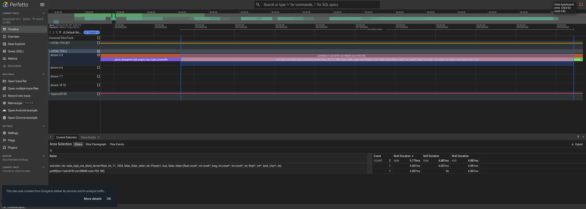
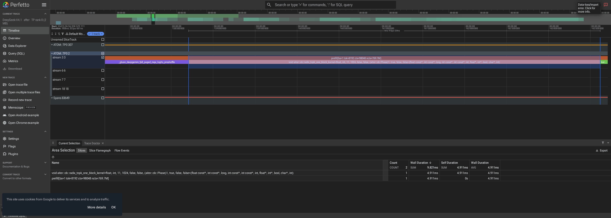
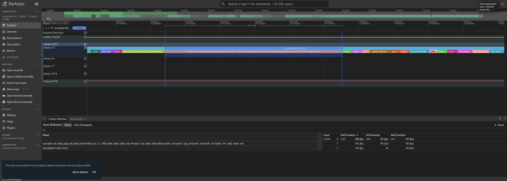
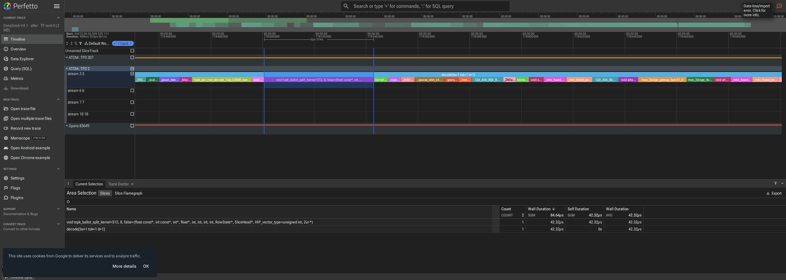

# Silo Ballot indexer top-k for DeepSeek-V4.1 Flash

## What

A prior native FP8 PTPC profile measured stable K=512 selection at 365–369 µs per Decode step, about 4.7% of the GPU graph span. Silo’s Ballot kernel uses wave ballots and popcount to reduce LDS atomic contention during radix counting. [Pinned AITER kernel](https://github.com/ROCm/aiter/commit/7f36447ac7a235d15d8de7b4598c2c167d85da67) · [ROCM-34375](https://amd.atlassian.net/browse/ROCM-34375)

| ATOM commit | Change |
|---|---|
| [`e309e00`](https://github.com/TianHao65/ATOM/commit/e309e005dfa83dd323dfb959b040d0af8bb6bceb) | Route stable K=512 selection from the paged FP8 index cache to Ballot on gfx942 single-token, non-tentative Decode. Ineligible calls fall back to the existing selector. |

Set `ATOM_DSV41_BALLOT_TOPK_LIB` to the shared library built from Silo’s pinned source with `hipcc -O3 --offload-arch=gfx942 -std=c++17 -shared -fPIC`.

## Data

`DeepSeek-V4.1-Flash-1017` (`08c8657`) ran on PTL52 MI308X with TP4 Base and native FP8 PTPC. Both arms used image `cfd987217fc4` (ATOM `5f6bdb75`, AITER `ad0d5e20`) and the same source overlay. The tested commit `e26da2a` and the linked branch commit `e309e00` have identical source trees. [Tested commit](https://github.com/TianHao65/ATOM/commit/e26da2ae6e2b7a85bd8cde2a9f67f8238a3f276f)

The sequential A/B used separate server starts with stable AITER selection before and Ballot after. Each start completed a smoke check and 90K shared-prefix warmup, then served eight matched C1 requests with 100,000 input and 150 output tokens. Every timed request hit 89,984 cached tokens. Profiling was disabled for client timing.

## Benchmarking and Profiling

| Concurrency | Output tokens/s | P50 TTFT (ms) | P50 TPOT (ms/token) | P50 ETE (ms) |
|---:|---:|---:|---:|---:|
| 1 | 81.43 → 82.13 (+0.85%) | 617.42 → 614.19 (−0.52%) | 7.582 → 7.487 (−1.25%) | 1,768.28 → 1,745.47 (−1.29%) |

Six of eight matched requests finished faster with Ballot. Median paired ETE delta was **−16.38 ms**. Mean TTFT rose from 705.31 to 706.51 ms (+0.17%).

Separate C1 TP4 100K/24 traces captured 24 Decode graph replays per rank. All four ranks executed seven unsplit and one split Ballot K512 call per Decode replay. K512 GPU work sums the eight kernel durations per replay. Decode graph span covers all correlated streams and Prefill sums the main-stream spans of two chunks.

| Rank 0 metric | Stable AITER → Ballot |
|---|---:|
| P50 K512 GPU work (µs/step) | 387.89 → 238.75 (−38.45%) |
| P50 Decode GPU graph span (ms/step) | 7.911 → 7.773 (−1.74%) |
| Prefill main-stream span sum (ms) | 569.41 → 569.60 (+0.03%) |

The rank 0 captures use the Prefill chunk with 8,192 tokens at context 98,048 and Decode graph 13 at batch size 1. The 102,400-column Decode selection is attributed to layer 20 from scorer and selector order. [Capture manifest and full trace SHA-256](perfetto/capture-manifest.json)

Each Perfetto link selects the shown kernel in the complete original trace. Press `F` in Perfetto to zoom to the selected slice.

### Prefill

**Before**

[Open prefill before in Perfetto](https://ui.perfetto.dev/#!/?url=https%3A%2F%2Fraw.githubusercontent.com%2FTianHao65%2FATOM%2F59cb8fa6db2481f2008cc042050d1b891f1e03c0%2Fperfetto%2Frank0-before.trace.json.gz&visStart=4635122885262156&visEnd=4635122891262156&table=slice&ts=4635122886262156&dur=4887456)

**After**

[Open prefill after in Perfetto](https://ui.perfetto.dev/#!/?url=https%3A%2F%2Fraw.githubusercontent.com%2FTianHao65%2FATOM%2F59cb8fa6db2481f2008cc042050d1b891f1e03c0%2Fperfetto%2Frank0-after.trace.json.gz&visStart=4635417096235593&visEnd=4635417102235593&table=slice&ts=4635417097235593&dur=4910534)

### Decode

**Before**

[Open decode before in Perfetto](https://ui.perfetto.dev/#!/?url=https%3A%2F%2Fraw.githubusercontent.com%2FTianHao65%2FATOM%2F59cb8fa6db2481f2008cc042050d1b891f1e03c0%2Fperfetto%2Frank0-before.trace.json.gz&visStart=4635123508072716&visEnd=4635123508312716&table=slice&ts=4635123508117716&dur=101759)

**After**

[Open decode after in Perfetto](https://ui.perfetto.dev/#!/?url=https%3A%2F%2Fraw.githubusercontent.com%2FTianHao65%2FATOM%2F59cb8fa6db2481f2008cc042050d1b891f1e03c0%2Fperfetto%2Frank0-after.trace.json.gz&visStart=4635417716984717&visEnd=4635417717224717&table=slice&ts=4635417717029717&dur=42319)

## Validation

- K2048 selection, MoE gating and Prefill indexer kernel counts matched across the A/B traces.
- A separate instrumented TP4 run compared stable AITER and Ballot on the same serving logits and live lengths. All **39,904** K512 calls produced identical indices.
- The timed A/B matched all eight prompts, cache hits and output lengths. SSE text hashes matched for **3/8** requests across server starts. The cause of the text differences remains open.
- GPU ownership sampling recorded zero overlap in both arms and the diagnostic. The benchmark port and owned GPU resources were released.
