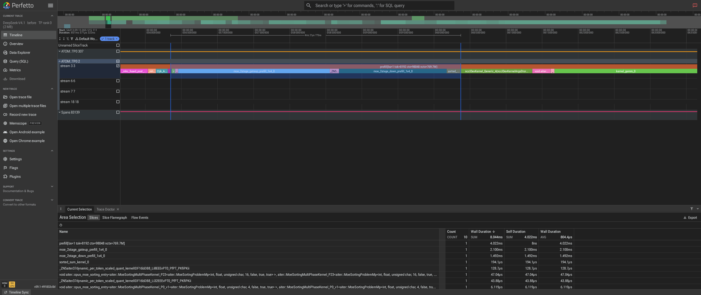
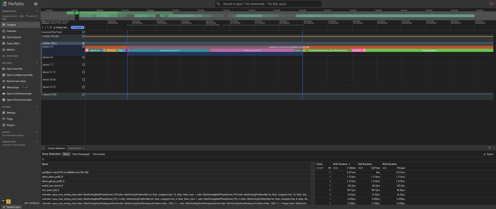
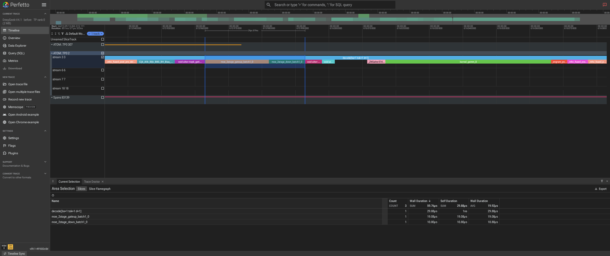
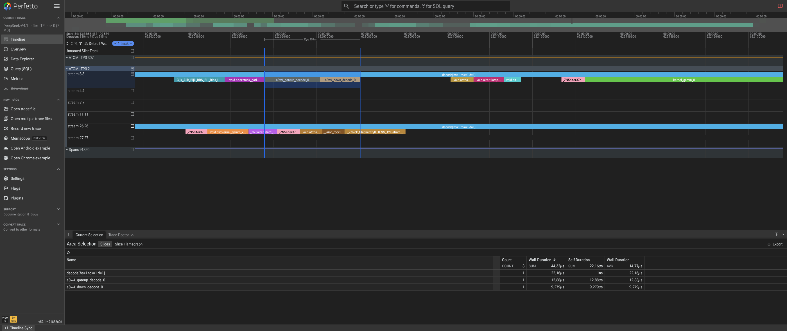

# Runtime A8W4 MoE on DeepSeek-V4.1-Flash-1017-FP4PTPC

## What

ATOM loads the checkpoint's native MXFP4 routed weights, packs them once for
Luocheng's PyHIP M13 kernels, and dispatches through `aiter.fused_moe`.
The gate/up and down GEMMs decode E2M1 weights to FP8 in registers and use
per-row E4M3FNUZ activations. The port applies the model's SwiGLU clamp before
the gate/up product, extends the decode kernel to H=5120, and masks padding
routes during graph replay. [ATOM port and dependency patches](https://github.com/TianHao65/ATOM/tree/d45c74a0db5ba1d24fec49113525ca30f1993821/tools/dsv41_luocheng_a8w4) · [Luocheng M13](https://github.com/luocheng25/pyhip/commit/a641da286511f3f8b703f90b3f9a1ea66b18301a)

The checkpoint's shared expert already uses FP8 PTPC. Original ATOM converts
the routed experts to FP8 PTPC during loading and fuses the shared slot.
The runtime A8W4 port computes the shared expert through ATOM's standalone
FP8 PTPC path and combines its output before the TP reduction. Both split
arms pad only the shared down GEMM from logical K=576 to physical K=640
with zeros. The routed intermediate remains 576. This handles the
gfx942 preshuffled FP8 kernel's K alignment at graph batch 64.

## Data

Checkpoint `ginsongsong/DeepSeek-V4.1-Flash-1017-FP4PTPC@97cc9b32`, 40 backbone
layers. PTL52 MI308X (gfx942, 80 CUs), TP4, DSpark off, BF16 KV cache and FP8
index cache. H=5120, global I=2304, rank-local I=576, 384 routed experts,
1 shared expert, routed top-k=6, routing scale 1.5, SwiGLU clamp 10.0.
Both PyHIP projections use I=576 after padding. The call takes BF16
`[M,5120]` activations and returns BF16 `[M,5120]` per rank.
The image is `cfd987217fc4` with PyTorch 2.10.0, ROCm 7.2.4,
FlyDSL 0.5.0, and AITER `ad0d5e20`. [Checkpoint config](https://huggingface.co/ginsongsong/DeepSeek-V4.1-Flash-1017-FP4PTPC/blob/97cc9b32c970864edce0f3fc186d3042b04e3a36/config.json) · [Original ATOM](https://github.com/ROCm/ATOM/commit/5f6bdb75c19a0e4bc57512ef425973d53f0f54f4) · [AITER revision](https://github.com/ROCm/aiter/commit/ad0d5e208eb2d49ab658c3c161aa5c3502dfc2a1)

| Arm | Experts in the fused call | Executed top-k | Routed weight format | Shared expert |
|---|---:|---:|---|---|
| Original ATOM | 385 | 7 | FP8 E4M3FNUZ, per-channel scale | Fused at expert ID 384 |
| ATOM PTPC, shared split | 384 | 6 | FP8 E4M3FNUZ, per-channel scale | Separate FP8 PTPC |
| Luocheng A8W4 | 384 | 6 | MXFP4 E2M1, one E8M0 scale per 32 K | Separate FP8 PTPC |

TP4 routed weight tensors before PyHIP packing are gate/up `[384,1152,2560]`
and down `[384,5120,288]` in packed bytes. Their scale tensors are
`[384,1152,160]` and `[384,5120,18]`. The matching operator benchmark uses
real layer 20 TP4 rank 0 expert and router tensors with seeded BF16 inputs
and identical post-top-k routes in both arms.

## Benchmarking and Profiling

### Routed MoE operator

Both arms call `aiter.fused_moe` on the same post-router inputs and expert
IDs. GPU events time the complete routed call, including sorting where
used, activation quantization, both GEMMs and reduction. Median over five
alternating windows of 30 graph replays; weight preparation is outside
the timing window. The clean run used PTL34 GPU 7 with the same image and
layer-20 shard SHA-256 as the PTL52 checkpoint. [Measurements and dispatch keys](moe-a8w4-timings.csv) · [Timing windows and validation](evidence/routed-moe.json) · [Benchmark script](evidence/bench_routed_moe.py)

| Rows M | ATOM FP8 PTPC (µs) | Luocheng A8W4 (µs) | Latency change | A8W4 path |
|---:|---:|---:|---:|---|
| 1 | 25.99 | 28.34 | +9.1% | Decode gate/up and down |
| 32 | 392.26 | 324.04 | −17.4% | Decode with prequantized rows |
| 64 | 625.00 | 492.55 | −21.2% | Streaming BM32 |
| 512 | 1,398.98 | 858.60 | −38.6% | Streaming BM16 |
| 2,048 | 1,735.91 | 1,647.89 | −5.1% | Streaming BM64 gate/up, prefill down |
| 8,192 | 3,916.53 | 3,661.19 | −6.5% | Opus sort, BM64/BN128/TK128 prefill |

AITER selected its default gfx942 FlyDSL configurations for the exact
`H5120/I576/E384/K6` FP8 PTPC key. The low-M schedules use BF16 MFMA with
FP8 weights. The prefill schedule quantizes the input and uses FP8 MFMA.
M1 had wider timing variation, with candidate windows from 26.60 to
52.51 µs. Standard AITER PTPC tuning rows for E385/K7 use a different key.
[AITER low-M implementation](https://github.com/ROCm/aiter/blob/ad0d5e208eb2d49ab658c3c161aa5c3502dfc2a1/aiter/ops/flydsl/kernels/moe_gemm_2stage/gfx9_fp8/common.py#L895)

### Serving A/B

PTL52 GPU 0–3, TP4, C1, eight matched 100,000-input/150-output requests
per arm, each with 89,984 cached tokens. The server uses an 8,192-token
prefill chunk cap, 102,400 maximum context, and graph sizes
`[1,2,4,8,16,32,48,64]`. The timing pass ran without profiling.

| Metric | Original ATOM, E385/K7 | FP8 PTPC split, E384/K6 | Luocheng A8W4, E384/K6 | A8W4 vs original |
|---|---:|---:|---:|---:|
| TTFT P50 (ms) | 612.90 | 624.14 | 620.69 | +1.27% |
| TPOT P50 (ms) | 7.45 | 8.39 | 8.43 | +13.25% |
| End-to-end P50 (ms) | 1,723.19 | 1,874.05 | 1,898.20 | +10.16% |
| Output throughput (tok/s) | 82.11 | 76.15 | 74.54 | −9.22% |
| Peak GPU memory at load, per rank (GB as logged) | 134.26 | 134.24 | 75.71 | −43.61% |

Against the matched FP8 PTPC split arm, A8W4 changes TTFT by −0.55%,
TPOT by +0.49%, and end-to-end latency by +1.29%. Splitting the shared
expert raises P50 TPOT by 0.95 ms with FP8 PTPC in both arms. The full
original-to-A8W4 TPOT difference is 0.99 ms. [Matched requests and means](evidence/serving.json)

### Serving profile

The separate 100K/24 capture uses a matched prompt and 89,984 cached tokens.
Rank-0 device-event durations below sum gate/up and down GEMMs within each
forward. The original kernels include the FP8 shared slot. The two split
columns show routed GEMMs. The standalone shared computations run on
the side stream in Decode.

| Rank-0 forward | Gate/up and down calls, each | Original (ms) | FP8 PTPC split (ms) | A8W4 (ms) |
|---|---:|---:|---:|---:|
| Prefill M=8192, context 98,048 | 20 | 67.498 | 59.590 | 61.074 |
| Final prefill 1,952 live rows in a 2,048-row buffer | 40 | 34.137 | 31.977 | 33.171 |
| Decode M=1, median over 24 forwards | 40 | 1.154 | 1.055 | 0.876 |

Bounded replay runs 20 routed layers during the non-final Prefill
chunk. The final Prefill forward also runs the 20 tail layers, with
smaller token counts for the bounded tail window.

The M=1 main-stream forward span is 8.031 ms original, 9.372 ms FP8 PTPC
split and 9.311 ms A8W4. Both split graphs have 280 extra shared-path
kernels per step on the side stream. These cover FP8 activation
quantization, gate/up, clamp and SiLU, intermediate quantization, zero
padding and down. The stage sums can overlap the routed work.
[Decode streams and GPU kernel counts](evidence/decode-streams.json)

The four images show the first audited rank-0 MoE call at M=8192 and M=1
with paired 8 ms and 150 µs viewports respectively. The selected spans
are 4,021.775 → 3,570.932 µs in Prefill and 29.879 → 22.159 µs in Decode.
The after selection covers the A8W4 routed kernels. In the selected
Decode step the shared down GEMM finishes 10.520 µs after routed down.
[Capture manifest and complete trace hashes](evidence/perfetto/capture-manifest.json)

[Open prefill before in Perfetto](https://ui.perfetto.dev/#!/?url=https%3A%2F%2Fraw.githubusercontent.com%2FTianHao65%2FATOM%2F77e1560fd3f781de7ad0fe740659f523700b427f%2Foperators%2Ffused-moe%2Fevidence%2Fperfetto%2Frank0-before.trace.json.gz&visStart=4712953121165218&visEnd=4712953129165218&table=slice&ts=4712953121972018&dur=2100168)

[Open prefill after in Perfetto](https://ui.perfetto.dev/#!/?url=https%3A%2F%2Fraw.githubusercontent.com%2FTianHao65%2FATOM%2F77e1560fd3f781de7ad0fe740659f523700b427f%2Foperators%2Ffused-moe%2Fevidence%2Fperfetto%2Frank0-after.trace.json.gz&visStart=4714556540322768&visEnd=4714556548322768&table=slice&ts=4714556541095129&dur=1573444)

[Open decode before in Perfetto](https://ui.perfetto.dev/#!/?url=https%3A%2F%2Fraw.githubusercontent.com%2FTianHao65%2FATOM%2F77e1560fd3f781de7ad0fe740659f523700b427f%2Foperators%2Ffused-moe%2Fevidence%2Fperfetto%2Frank0-before.trace.json.gz&visStart=4712953681448085&visEnd=4712953681598085&table=slice&ts=4712953681478085&dur=19079)

[Open decode after in Perfetto](https://ui.perfetto.dev/#!/?url=https%3A%2F%2Fraw.githubusercontent.com%2FTianHao65%2FATOM%2F77e1560fd3f781de7ad0fe740659f523700b427f%2Foperators%2Ffused-moe%2Fevidence%2Fperfetto%2Frank0-after.trace.json.gz&visStart=4714557104137475&visEnd=4714557104287475&table=slice&ts=4714557104167475&dur=12879)

## Validation

Synthetic clamp-stress tests passed for M=1, 4, 16, 128 and 4096 at the
DeepSeek TP4 dimensions on FlyDSL 0.5.0. Maximum absolute error divided by
the FP32 reference peak ranged from 0.165% to 0.376%. At M=16, graph replay
kept unmasked rows bitwise equal and returned zero on the masked row.

On checkpoint weights, all sampled outputs were finite. A8W4 NRMSE to
the same dequantized-weight FP32 reference was 4.42–4.63%. The PTPC path
was 1.65–1.77% at M≤64 and 4.74–4.75% at M≥512. PyHIP rebases E8M0 scales
per weight row and zeros groups with exponent delta greater than 11.
These measurements cover a routed layer. Model-level task accuracy was
outside this run.

All six timing buckets from the first PTL52 single-GPU run overlapped a
new SGLang workload and were excluded from the table. The PTL34 repeat
had zero observed foreign GPU processes across 111 samples.

All three variants returned 8/8 timed responses, with zero observed foreign
GPU process samples on the selected cards. In both paired comparisons
with A8W4, two of eight output text hashes matched across starts. All eight
graph sizes captured successfully after the shared down GEMM alignment
fix. An isolated shared-down check with real layer-20 weights passed
11 M values at each of K640 and K768. Graph outputs equaled eager
bitwise, and the maximum NRMSE against FP32 was 0.00916%. This check
recorded correctness only. [Validation samples](evidence/routed-moe.json)

The split FP8 arm reused the candidate's compiled shared GEMM binaries
from the same pinned AITER and image and performed its ordinary warmup.
The original arm's quantization ledger was ephemeral. Its server log
confirms all 40 expert layers converted on all four ranks, and the native
trace shows a seven-slot batch-one gate/up grid. Task serving containers and
their client port were released and the selected GPUs returned to idle.
