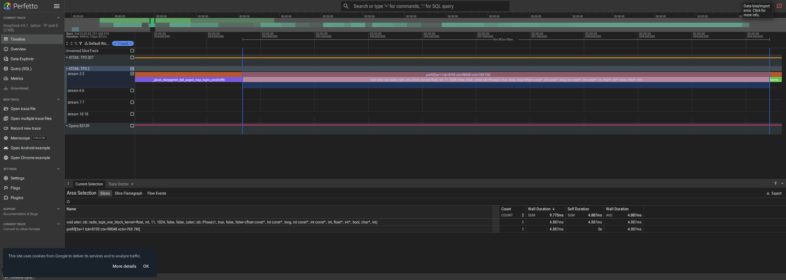
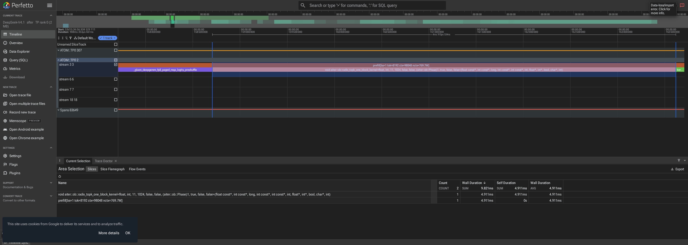
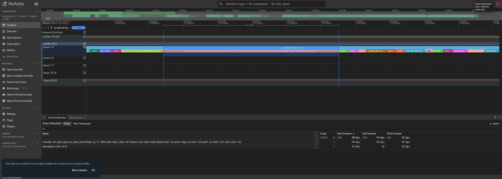

# DeepSeek-V4.1-Flash model latency breakdown on MI308X

## What

This evaluation compares whole-model inference with the default ATOM selectors and with AITER Ballot enabled. Mean E2E latency was **0.85% lower** with AITER Ballot in the 100K/150 serving A/B. In the separate 100K/24 Ballot profile, attention and its indexer accounted for **52.79%** of total GPU work, followed by **MoE (21.44%)** and **mHC (13.68%)**. The profile follows the full forward path from embedding and Engram through the output head and sampling. [ROCM-34375](https://amd.atlassian.net/browse/ROCM-34375) · [AITER Ballot implementation](https://github.com/ROCm/aiter/commit/7f36447ac7a235d15d8de7b4598c2c167d85da67) · [Isolated selector A/B](indexer-topk-tp4.md)

## Data

| Parameter | Setting |
|---|---|
| Model | DeepSeek-V4.1-Flash-1017 `08c8657`, native online FP8 PTPC for FFN experts, BF16 KV cache, FP8 index cache |
| Checkpoint dimensions | 40 layers, hidden size 5,120, expert intermediate size 2,304, 384 routed experts, 1 shared expert, 6 routed selections per token, mHC expansion factor 4, Engram at layers 1 and 14 |
| Platform | Four MI308X GPUs (gfx942) on PTL52, TP4 Base, concurrency 1, DSpark off |
| Software | Both arms used tested ATOM source `e26da2a`, AITER `ad0d5e20`, image `cfd987217fc4`, PyTorch 2.10.0 and ROCm 7.2.4. |
| Selector | The ATOM baseline used the default FlyDSL and HIP radix selectors. The AITER Ballot arm enabled the library built from the linked AITER commit. |
| Dispatch | Stable K=512, one query token, non-tentative Decode. FP32 logits shapes per graph were `[1, 16384]` × 4, `[1, 51200]` × 3, and `[1, 102400]` × 1. |
| Serving A/B | 100,000 input / 150 output tokens, greedy generation, 8 matched prompts, one server start per arm, profiler off |
| Prefix and chunking | 90,000-token shared prefix warmup, 89,984 cached tokens per measured request, maximum Prefill chunk size 8,192 |
| Profile A/B | One separate 100,000 input / 24 output request per arm with matching prompt and cache hit, two Prefill chunks and 24 Decode graph replays per rank |

[Tested ATOM revision](https://github.com/TianHao65/ATOM/commit/e26da2ae6e2b7a85bd8cde2a9f67f8238a3f276f) · [Trace capture manifest and SHA-256](../../perfetto/capture-manifest.json)

## Benchmarking and Profiling

### Client end-to-end composition

TTFT is measured from request start to the first nonempty SSE content or reasoning delta. The post-first-token interval runs through SSE completion and equals `E2E − TTFT` or `149 × TPOT` for these requests. Mean component times are computed per request and add up to mean E2E.

| Client interval | ATOM baseline mean (ms) | AITER Ballot mean (ms) | AITER Ballot − baseline (ms) |
|---|---:|---:|---:|
| Request start to first token | 705.310 (38.37%) | 706.507 (38.77%) | +1.197 |
| First token to stream completion | 1,132.716 (61.63%) | 1,115.847 (61.23%) | −16.869 |
| **Total E2E** | **1,838.026** | **1,822.354** | **−15.672 (−0.85%)** |

| Concurrency | Output tok/s | P50 TTFT (ms) | P50 TPOT (ms/token) | P50 E2E (ms) |
|---:|---:|---:|---:|---:|
| 1 | 81.43 → 82.13 (+0.85%) | 617.42 → 614.19 (−0.52%) | 7.582 → 7.487 (−1.25%) | 1,768.28 → 1,745.47 (−1.29%) |

Six of eight requests completed faster. The median of the eight paired E2E differences was −16.38 ms.

Matched client timings in milliseconds

| Prompt suffix seed | Baseline TTFT | Baseline E2E | AITER Ballot TTFT | AITER Ballot E2E |
|---:|---:|---:|---:|---:|
| 1000 | 1,328.621 | 2,436.713 | 1,338.497 | 2,428.920 |
| 1001 | 618.644 | 1,731.134 | 617.193 | 1,713.543 |
| 1002 | 614.677 | 1,781.506 | 614.718 | 1,708.852 |
| 1003 | 621.175 | 1,776.534 | 645.364 | 1,785.553 |
| 1004 | 608.690 | 1,715.566 | 608.654 | 1,700.405 |
| 1005 | 615.359 | 1,726.203 | 607.828 | 1,750.622 |
| 1006 | 619.114 | 1,773.372 | 613.672 | 1,748.475 |
| 1007 | 616.198 | 1,763.181 | 606.131 | 1,742.464 |

### Whole-model GPU time by module

Each cell shows **ATOM baseline → AITER Ballot** for rank 0. The full-request column sums both Prefill chunks (`8192 @ ctx=98048` and `1952/2048 @ ctx=100000`) and all 24 Decode steps. The other columns show the sum across Prefill and the mean across Decode. Percentages use the corresponding column's total GPU kernel and device-copy time, including overlapping streams.

| Module | Full profiled request, ms (share) | Prefill, ms (share) | Decode, ms/step (share) |
|---|---:|---:|---:|
| **Attention projections, RoPE, sparse attention and KV** | **322.486 (42.03%) → 323.313 (42.27%)** | 249.574 (43.58%) → 250.114 (43.62%) | 3.038 (37.44%) → 3.050 (38.23%) |
| **MoE routing and expert compute** | **164.012 (21.37%) → 163.998 (21.44%)** | 119.046 (20.79%) → 118.782 (20.72%) | 1.874 (23.09%) → 1.884 (23.62%) |
| **mHC** | **104.688 (13.64%) → 104.647 (13.68%)** | 68.374 (11.94%) → 68.060 (11.87%) | 1.513 (18.65%) → 1.524 (19.11%) |
| Indexer projections, scoring, selection and metadata | 83.480 (10.88%) → 80.465 (10.52%) | 63.631 (11.11%) → 63.716 (11.11%) | 0.827 (10.19%) → 0.698 (8.75%) |
| TP collectives | 65.789 (8.57%) → 65.824 (8.61%) | 53.526 (9.35%) → 54.490 (9.50%) | 0.511 (6.30%) → 0.472 (5.92%) |
| Token embedding and Engram | 21.040 (2.74%) → 21.307 (2.79%) | 17.061 (2.98%) → 17.338 (3.02%) | 0.166 (2.04%) → 0.165 (2.07%) |
| Final RMSNorm and LM head | 3.212 (0.42%) → 3.171 (0.41%) | 0.143 (0.03%) → 0.138 (0.02%) | 0.128 (1.58%) → 0.126 (1.58%) |
| Greedy sampling | 0.274 (0.04%) → 0.265 (0.03%) | 0.011 (<0.01%) → 0.011 (<0.01%) | 0.011 (0.13%) → 0.011 (0.13%) |
| Device copies | 1.664 (0.22%) → 1.088 (0.14%) | 1.155 (0.20%) → 0.577 (0.10%) | 0.021 (0.26%) → 0.021 (0.27%) |
| Other runtime GPU kernels | 0.715 (0.09%) → 0.723 (0.09%) | 0.117 (0.02%) → 0.120 (0.02%) | 0.025 (0.31%) → 0.025 (0.31%) |
| **Total GPU work** | **767.361 (100%) → 764.801 (100%)** | **572.638 (100%) → 573.347 (100%)** | **8.113 (100%) → 7.977 (100%)** |

GPU events were matched to HIP launches within the outer `ATOM::forward` annotations, including input preparation and postprocessing. Model kernels were assigned once by kernel family and launcher context. Generic GEMMs in graph replays were attributed by their position relative to attention projection, router, and Engram markers. The mHC row includes state initialization, fused pre/post, and the final collapse. TP communication includes LM-head all-gather and sampled-token broadcast. The LM head runs after the Decode graph, followed by greedy sampling in postprocessing. [ATOM model runtime](https://github.com/TianHao65/ATOM/blob/e26da2ae6e2b7a85bd8cde2a9f67f8238a3f276f/atom/models/deepseek_v41/runtime.py#L425) · [ATOM runner](https://github.com/TianHao65/ATOM/blob/e26da2ae6e2b7a85bd8cde2a9f67f8238a3f276f/atom/model_engine/model_runner.py#L3809)

### Remaining bottlenecks

- **Prefill.** Paged sparse attention is the largest submodule at **171.40 ms (29.89%)**, followed within the attention path by projections and KV/window preparation at **78.71 ms** and indexer scoring at **46.69 ms**. Both arms used the same 12 HIP radix selector calls in Prefill.
- **Decode.** Attention accounts for **3.050 ms/step (38.23%)** with AITER Ballot, including **1.234 ms** of projection GEMMs and **0.708 ms** of sparse attention. MoE accounts for **1.884 ms/step (23.62%)**, with **0.746 ms** in expert Gate/Up and **0.417 ms** in expert Down. mHC accounts for **1.524 ms/step (19.11%)**. K512 selection plus split scratch initialization accounts for **0.245 ms/step (3.07%)**.

| Rank-0 Decode metric | ATOM baseline → AITER Ballot |
|---|---:|
| P50 K512 kernel work | 387.89 → 238.75 µs/step (−38.45%) |
| P50 GPU graph span | 7.911 → 7.773 ms/step (−1.74%) |
| P50 full step GPU span, preparation through postprocess | 8.165 → 8.027 ms/step (−1.69%) |

Stable K512 selection represented **4.90%** of the baseline median Decode graph span. Including split workspace zeroing, the selector averaged **0.140 ms less per step** with AITER Ballot. Sustaining that saving over the 149 post-first-token intervals in the serving workload would account for about **21 ms**, or **1.1%** of baseline mean E2E, if it carries through to the request's latency path.

Wall-time cross-check for the profiled request

The 100K/24 profiles account for about 75% Prefill and 25% Decode by summed GPU activity in the module table. The HTTP wall-time view below uses the client request start and finish timestamps to clip the original rank-0 trace intervals. It uses the union of GPU activity on that timeline so each interval contributes once.

| Time within the instrumented HTTP request | ATOM baseline (ms) | AITER Ballot (ms) |
|---|---:|---:|
| GPU kernels in the Prefill model execution | 568.485 (70.93%) | 568.691 (67.00%) |
| GPU kernels in the Decode model execution, including the LM head | 190.685 (23.79%) | 187.653 (22.11%) |
| Other captured GPU activity, including input staging, copies, and sampling | 1.924 (0.24%) | 1.932 (0.23%) |
| Time with no captured rank-0 GPU activity | 40.393 (5.04%) | 90.528 (10.67%) |
| **HTTP span of the profiled request** | **801.487 (100%)** | **848.805 (100%)** |

The profiled AITER Ballot request spent **84.20 ms** before the first captured GPU event, versus **34.06 ms** in the baseline capture. Client, scheduler, and profiling contributions within that interval remain unassigned. The 100K/150 table above measures serving latency with the profiler off.

The UTC windows on 2026-11-24 were `03:49:08.798839–03:49:09.600326` for the ATOM baseline and `03:54:02.959027–03:54:03.807832` for AITER Ballot. Kineto's `baseTimeNanoseconds` aligns event timestamps to those windows.

Original Perfetto samples

The existing rank-0 samples show the first Prefill chunk and the 102,400-column K512 call in Decode replay 13. The tables above use both Prefill chunks and all 24 Decode replays. [Complete original trace hashes and sample windows](../../perfetto/capture-manifest.json)

**Prefill with ATOM baseline**

[Open prefill before in Perfetto](https://ui.perfetto.dev/#!/?url=https%3A%2F%2Fraw.githubusercontent.com%2FTianHao65%2FATOM%2F59cb8fa6db2481f2008cc042050d1b891f1e03c0%2Fperfetto%2Frank0-before.trace.json.gz&visStart=4635122885262156&visEnd=4635122891262156&table=slice&ts=4635122886262156&dur=4887456)

**Prefill with AITER Ballot**

[Open prefill after in Perfetto](https://ui.perfetto.dev/#!/?url=https%3A%2F%2Fraw.githubusercontent.com%2FTianHao65%2FATOM%2F59cb8fa6db2481f2008cc042050d1b891f1e03c0%2Fperfetto%2Frank0-after.trace.json.gz&visStart=4635417096235593&visEnd=4635417102235593&table=slice&ts=4635417097235593&dur=4910534)

**Decode with ATOM baseline**

[Open decode before in Perfetto](https://ui.perfetto.dev/#!/?url=https%3A%2F%2Fraw.githubusercontent.com%2FTianHao65%2FATOM%2F59cb8fa6db2481f2008cc042050d1b891f1e03c0%2Fperfetto%2Frank0-before.trace.json.gz&visStart=4635123508072716&visEnd=4635123508312716&table=slice&ts=4635123508117716&dur=101759)

**Decode with AITER Ballot**

[Open decode after in Perfetto](https://ui.perfetto.dev/#!/?url=https%3A%2F%2Fraw.githubusercontent.com%2FTianHao65%2FATOM%2F59cb8fa6db2481f2008cc042050d1b891f1e03c0%2Fperfetto%2Frank0-after.trace.json.gz&visStart=4635417716984717&visEnd=4635417717224717&table=slice&ts=4635417717029717&dur=42319)

## Validation

- All eight original rank trace files matched their capture hashes. On rank 0, the module table accounts for every captured kernel and GPU copy, **25,375** events in the baseline and **25,399** with AITER Ballot. The dominant model modules agreed across TP ranks.
- Each AITER Ballot rank ran seven unsplit and one split K512 Ballot kernel per Decode graph. K2048 selection and MoE gating call counts matched across arms.
- The serving A/B matched all eight prompts, cache hit counts, and output lengths. GPU ownership sampling reported zero overlap. One server start per arm limits the estimate of run-to-run variation.
- A separate shadow run returned identical stable top-k indices on all **39,904** same-logits comparisons. The timed requests matched SSE output hashes on **3/8** pairs. The cause of the output differences remains unresolved. [Selector validation](indexer-topk-tp4.md#validation)
