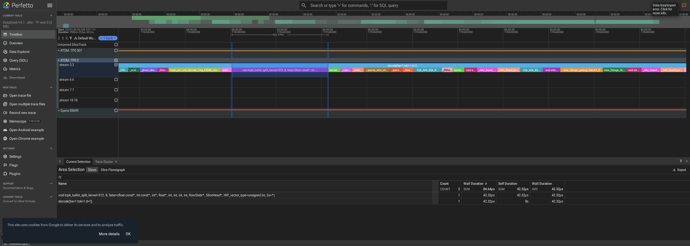

# DeepSeek-V4.1-Flash indexer top-k end-to-end evaluation

## What

This evaluation measures request latency and GPU operator time with the default ATOM selectors and with AITER Ballot enabled. In the 100K/150 serving A/B, about **62% of mean request latency** came after the first token. In the AITER Ballot arm, that interval was **16.87 ms shorter** and mean end-to-end latency was **15.67 ms lower (0.85%)**. Stable K512 selection accounted for **4.90%** of the baseline median Decode GPU graph span. With AITER Ballot enabled, the largest GPU time contributors were paged sparse attention in Prefill and the attention path, MoE, and mHC in Decode. [ROCM-34375](https://amd.atlassian.net/browse/ROCM-34375) · [AITER Ballot implementation](https://github.com/ROCm/aiter/commit/7f36447ac7a235d15d8de7b4598c2c167d85da67) · [Selector A/B](indexer-topk-tp4.md)

## Data

| Parameter | Setting |
|---|---|
| Model | DeepSeek-V4.1-Flash-1017 `08c8657`, native online FP8 PTPC for FFN experts, BF16 KV cache, FP8 index cache |
| Platform | Four MI308X GPUs (gfx942) on PTL52, TP4 Base, concurrency 1, DSpark off |
| Software | Both arms used ATOM `e26da2a`, AITER `ad0d5e20`, image `cfd987217fc4`, PyTorch 2.10.0 and ROCm 7.2.4. |
| Selector | The ATOM baseline used the default FlyDSL and HIP radix selectors. The AITER Ballot arm enabled the library built from the linked AITER commit. |
| Dispatch | Stable K=512, one query token, non-tentative Decode. FP32 logits shapes per graph were `[1, 16384]` × 4, `[1, 51200]` × 3, and `[1, 102400]` × 1. |
| Serving A/B | 100,000 input / 150 output tokens, greedy generation, 8 matched prompts, one server start per arm, profiler off |
| Prefix and chunking | 90,000-token shared prefix warmup, 89,984 cached tokens per measured request, maximum Prefill chunk size 8,192 |
| Profile A/B | One separate 100,000 input / 24 output request per arm with matching prompt and cache hit, two Prefill chunks and 24 Decode graph replays per rank |

[Tested ATOM revision](https://github.com/TianHao65/ATOM/commit/e26da2ae6e2b7a85bd8cde2a9f67f8238a3f276f) · [Trace capture manifest and SHA-256](../../perfetto/capture-manifest.json)

## Benchmarking and Profiling

### Client end-to-end composition

TTFT is measured from request start to the first nonempty SSE content or reasoning delta. The post-first-token interval runs through SSE completion and equals `E2E − TTFT` or `149 × TPOT` for these requests. Mean component times are computed per request and add up to mean E2E.

| Client interval | ATOM baseline mean (ms) | AITER Ballot mean (ms) | AITER Ballot − baseline (ms) |
|---|---:|---:|---:|
| Request start to first token | 705.310 (38.37%) | 706.507 (38.77%) | +1.197 |
| First token to stream completion | 1,132.716 (61.63%) | 1,115.847 (61.23%) | −16.869 |
| **Total E2E** | **1,838.026** | **1,822.354** | **−15.672 (−0.85%)** |

| Concurrency | Output tok/s | P50 TTFT (ms) | P50 TPOT (ms/token) | P50 E2E (ms) |
|---:|---:|---:|---:|---:|
| 1 | 81.43 → 82.13 (+0.85%) | 617.42 → 614.19 (−0.52%) | 7.582 → 7.487 (−1.25%) | 1,768.28 → 1,745.47 (−1.29%) |

Six of eight requests completed faster. The median of the eight paired E2E differences was −16.38 ms.

Matched client timings in milliseconds

| Prompt suffix seed | Baseline TTFT | Baseline E2E | AITER Ballot TTFT | AITER Ballot E2E |
|---:|---:|---:|---:|---:|
| 1000 | 1,328.621 | 2,436.713 | 1,338.497 | 2,428.920 |
| 1001 | 618.644 | 1,731.134 | 617.193 | 1,713.543 |
| 1002 | 614.677 | 1,781.506 | 614.718 | 1,708.852 |
| 1003 | 621.175 | 1,776.534 | 645.364 | 1,785.553 |
| 1004 | 608.690 | 1,715.566 | 608.654 | 1,700.405 |
| 1005 | 615.359 | 1,726.203 | 607.828 | 1,750.622 |
| 1006 | 619.114 | 1,773.372 | 613.672 | 1,748.475 |
| 1007 | 616.198 | 1,763.181 | 606.131 | 1,742.464 |

### Prefill GPU time

Rank 0 had two Prefill chunks, `8192 @ ctx=98048` and `1952/2048 @ ctx=100000` as recorded by ATOM. GPU kernels were attributed by matching HIP launch correlations inside each Prefill annotation. The table sums per-family durations on the main GPU stream across both chunks. Percentages use the AITER Ballot arm's 569.60 ms main-stream span.

| Prefill GPU work | ATOM baseline (ms) | AITER Ballot (ms) | AITER Ballot span share |
|---|---:|---:|---:|
| **Paged sparse attention, including split and combine** | **171.38** | **171.40** | **30.09%** |
| MoE expert Gate/Up, Down, gating, sort and reduction | 109.71 | 109.47 | 19.22% |
| Dense GEMM and BMM | 91.29 | 91.23 | 16.02% |
| mHC | 67.16 | 66.82 | 11.73% |
| TP collectives | 51.83 | 52.31 | 9.18% |
| Indexer FP8 MQA scoring | 46.60 | 46.69 | 8.20% |
| Indexer HIP radix selection | 15.16 | 15.16 | 2.66% |
| Remaining kernels | 15.20 | 15.60 | 2.74% |
| Gaps between kernels | 1.09 | 0.92 | 0.16% |
| **Main-stream span, both chunks** | **569.41** | **569.60** | **100%** |

Paged sparse attention, scoring, and radix selection together account for **233.25 ms (40.95%)** of the AITER Ballot arm's Prefill GPU span. Sparse attention itself is the largest component at **171.40 ms**. Both arms ran 12 HIP radix kernels and zero Ballot kernels in Prefill.

### Decode GPU time

Each Decode scope was matched to one HIP graph launch at batch 1 and one query token. The table shows mean summed kernel durations over 24 rank-0 replays and shares of summed GPU work for the AITER Ballot arm. The two GPU streams overlap by about 45 µs per step, so the measured graph span is reported separately. The profile used a separate request from the serving benchmark.

| Decode GPU work | ATOM baseline (ms/step) | AITER Ballot (ms/step) | AITER Ballot work share |
|---|---:|---:|---:|
| **Attention projections, norm/RoPE/quant, and sparse attention** | **2.916** | **2.929** | **37.65%** |
| **MoE router GEMM, gating and expert Gate/Up + Down** | **1.874** | **1.884** | **24.22%** |
| **mHC** | **1.494** | **1.505** | **19.35%** |
| TP all-reduce | 0.479 | 0.439 | 5.65% |
| K512 selection kernels | 0.385 | 0.240 | 3.08% |
| Ballot split workspace zeroing | 0 | 0.005 | 0.06% |
| Indexer FP8 MQA scoring | 0.044 | 0.047 | 0.60% |
| Indexer K2048, maxima, lift, and weight scaling | 0.089 | 0.087 | 1.12% |
| Remaining kernels | 0.633 | 0.643 | 8.27% |
| **Summed GPU kernel work** | **7.913** | **7.779** | **100%** |

Attention in the AITER Ballot arm breaks down into **1.234 ms** for QKV/Q/output projections, **0.986 ms** for norm, RoPE and projection-input quantization, and **0.708 ms** for paged sparse attention. Projection attribution follows the Q/K norm, RoPE, inverse RoPE, and all-reduce markers in each layer. MoE includes the router GEMM immediately preceding each expert-gating kernel. [ATOM attention implementation](https://github.com/TianHao65/ATOM/blob/e26da2ae6e2b7a85bd8cde2a9f67f8238a3f276f/atom/models/deepseek_v41/attention.py)

| Rank-0 profile metric | ATOM baseline → AITER Ballot |
|---|---:|
| P50 K512 kernel work | 387.89 → 238.75 µs/step (−38.45%) |
| P50 GPU graph span | 7.911 → 7.773 ms/step (−1.74%) |

Including split workspace zeroing, mean selector time was **0.140 ms lower per step** in the AITER Ballot arm, a difference equivalent to about **1.8%** of the baseline mean graph span. Over 149 post-first-token intervals, this corresponds to about **21 ms**, or **1.1%** of baseline mean E2E, if the per-step savings carry through to request latency. The trace identifies which operators take the most GPU time. Hardware-level attribution within those operators remains open.

Original Perfetto samples

The existing rank-0 samples show the first Prefill chunk and the 102,400-column K512 call in Decode replay 13. The tables above use both Prefill chunks and all 24 Decode replays. [Complete original trace hashes and sample windows](../../perfetto/capture-manifest.json)

**Prefill with ATOM baseline**

[Open prefill before in Perfetto](https://ui.perfetto.dev/#!/?url=https%3A%2F%2Fraw.githubusercontent.com%2FTianHao65%2FATOM%2F59cb8fa6db2481f2008cc042050d1b891f1e03c0%2Fperfetto%2Frank0-before.trace.json.gz&visStart=4635122885262156&visEnd=4635122891262156&table=slice&ts=4635122886262156&dur=4887456)

**Prefill with AITER Ballot**

[Open prefill after in Perfetto](https://ui.perfetto.dev/#!/?url=https%3A%2F%2Fraw.githubusercontent.com%2FTianHao65%2FATOM%2F59cb8fa6db2481f2008cc042050d1b891f1e03c0%2Fperfetto%2Frank0-after.trace.json.gz&visStart=4635417096235593&visEnd=4635417102235593&table=slice&ts=4635417097235593&dur=4910534)

**Decode with ATOM baseline**

[Open decode before in Perfetto](https://ui.perfetto.dev/#!/?url=https%3A%2F%2Fraw.githubusercontent.com%2FTianHao65%2FATOM%2F59cb8fa6db2481f2008cc042050d1b891f1e03c0%2Fperfetto%2Frank0-before.trace.json.gz&visStart=4635123508072716&visEnd=4635123508312716&table=slice&ts=4635123508117716&dur=101759)

**Decode with AITER Ballot**

[Open decode after in Perfetto](https://ui.perfetto.dev/#!/?url=https%3A%2F%2Fraw.githubusercontent.com%2FTianHao65%2FATOM%2F59cb8fa6db2481f2008cc042050d1b891f1e03c0%2Fperfetto%2Frank0-after.trace.json.gz&visStart=4635417716984717&visEnd=4635417717224717&table=slice&ts=4635417717029717&dur=42319)

## Validation

- All eight original rank trace files matched their capture hashes. In the AITER Ballot arm, each rank ran seven unsplit and one split K512 Ballot kernel per replay. K2048 selection and MoE gating call counts matched across arms. Operator rankings were consistent across all four ranks in the AITER Ballot arm.
- The serving A/B matched all eight prompts, cache hit counts, and output lengths. GPU ownership sampling reported zero overlap. One server start per arm limits the estimate of run-to-run variation.
- A separate shadow run returned identical stable top-k indices on all **39,904** same-logits comparisons. The timed requests matched SSE output hashes on **3/8** pairs. The cause of the output differences remains unresolved. [Selector validation](indexer-topk-tp4.md#validation)
