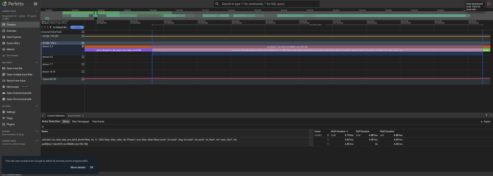
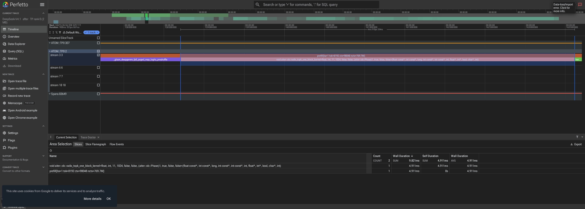
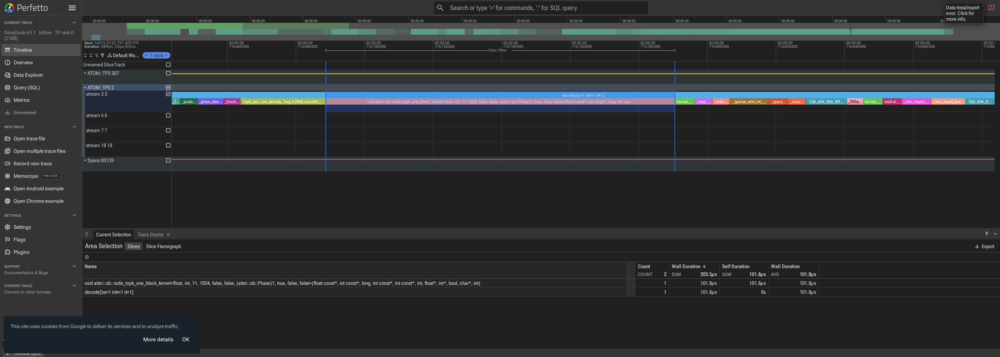
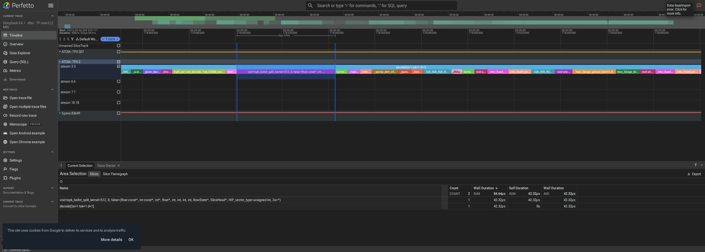

# Stable K512 indexer top-k on MI308X

## What

The ATOM adapter sends stable K=512 selection for the gfx942 FP8 paged index cache to the AITER Ballot kernel in non-tentative, single-token Decode. Ballot uses wave ballots and popcount to reduce LDS atomic contention during radix counting. The ATOM baseline uses AITER FlyDSL for the 16,384-column rows and HIP radix selection for longer rows. Set `ATOM_DSV41_BALLOT_TOPK_LIB` to the shared library built with `hipcc -O3 --offload-arch=gfx942 -std=c++17 -shared -fPIC`. [ATOM adapter](https://github.com/TianHao65/ATOM/commit/e309e005dfa83dd323dfb959b040d0af8bb6bceb) · [AITER Ballot kernel](https://github.com/ROCm/aiter/commit/7f36447ac7a235d15d8de7b4598c2c167d85da67)

## Data

| Parameter | Setting |
|---|---|
| Model and serving topology | DeepSeek-V4.1-Flash-1017 `08c8657`, TP4 Base, native FP8 PTPC, C1 |
| Device and runtime | PTL52 MI308X (gfx942), image `cfd987217fc4`, PyTorch 2.10.0, ROCm 7.2.4, AITER `ad0d5e20` |
| Isolated selector | One GPU, batch 1, `next_n=1`, `k=512`, `stable=True`, FP32 logits `[1, physical columns]`, int32 output `[1, 512]` |
| Isolated inputs | Both arms use the same logits from a synthetic FP8 paged MQA scorer with 8-token pages. The table lists physical and live columns at the 100K input boundary. |
| End-to-end | 100,000 input / 150 output tokens, 8 matched requests per arm, separate server starts, 90K shared-prefix warmup, 89,984 cached tokens per request, profiler off |
| Profiling | Separate 100,000 input / 24 output run per arm with 24 Decode graph replays per rank |

Both server arms used the same image and source tree, tested at `e26da2a`. The AITER Ballot arm enabled the Ballot library. The delivery notes list TP4 ATOM launchers. SGLang revision `baa9befa` contains the paged top-k v2 selector referenced in the table. [Tested commit](https://github.com/TianHao65/ATOM/commit/e26da2ae6e2b7a85bd8cde2a9f67f8238a3f276f) · [SGLang top-k v2 dispatch](https://github.com/sgl-project/sglang/blob/baa9befa381511cd4d56f83980951e5a45fffc6d/python/sglang/srt/layers/attention/dsv4/indexer.py#L446)

## Benchmarking and Profiling

### Isolated selector

Each arm warms up with three eager calls and one CUDA graph replay. Latencies are the medians of eight GPU-event means over 200 replays per arm and shape, with alternating arm order and one selector call per replay. Timing includes split scratch zeroing. The weighted sum uses ATOM’s observed calls per Decode step.

| Physical columns | Live columns | Calls per step | ATOM baseline (µs) | SGLang paged top-k v2 (µs) | AITER Ballot (µs) | AITER Ballot speedup vs baseline |
|---:|---:|---:|---:|---:|---:|---:|
| 16,384 | 16,384 | 4 | 26.77 | | 16.31 | 1.64× |
| 51,200 | 50,000 | 3 | 46.54 | | 22.90 | 2.03× |
| 102,400 | 100,000 | 1 | 78.47 | | 27.24 | 2.88× |
| **Weighted µs/step** | | **8** | **325.15** | | **161.20** | **2.02×** |

The isolated weighted sum fell by **50.42%**. [Per-round data](indexer-topk-tp4.json)

### End-to-end A/B

| Concurrency | Output tokens/s | P50 TTFT (ms) | P50 TPOT (ms/token) | P50 ETE (ms) |
|---:|---:|---:|---:|---:|
| 1 | 81.43 → 82.13 (+0.85%) | 617.42 → 614.19 (−0.52%) | 7.582 → 7.487 (−1.25%) | 1,768.28 → 1,745.47 (−1.29%) |

Six of eight requests finished faster with Ballot. Median paired ETE delta was −16.38 ms. Mean TTFT rose from 705.31 to 706.51 ms (+0.17%).

### Rank 0 trace

| Metric | ATOM baseline → AITER Ballot |
|---|---:|
| P50 Decode K512 GPU work (µs/step) | 387.89 → 238.75 (−38.45%) |
| P50 Decode GPU graph span (ms/step) | 7.911 → 7.773 (−1.74%) |
| Prefill main-stream span, sum of two chunks (ms) | 569.41 → 569.60 (+0.03%) |

All four ranks ran seven unsplit and one split Ballot K512 call per Decode replay. Rank 0 screenshots show the 8,192-token Prefill chunk at context 98,048 and Decode graph 13 at batch 1. The selected 102,400-column Decode call is attributed to layer 20 by scorer and selector order. Each Perfetto link selects the slice in the original trace. Press `F` to zoom. [Capture manifest and full trace SHA-256](../../perfetto/capture-manifest.json)

### Prefill

**Before**

[Open prefill before in Perfetto](https://ui.perfetto.dev/#!/?url=https%3A%2F%2Fraw.githubusercontent.com%2FTianHao65%2FATOM%2F59cb8fa6db2481f2008cc042050d1b891f1e03c0%2Fperfetto%2Frank0-before.trace.json.gz&visStart=4635122885262156&visEnd=4635122891262156&table=slice&ts=4635122886262156&dur=4887456)

**After**

[Open prefill after in Perfetto](https://ui.perfetto.dev/#!/?url=https%3A%2F%2Fraw.githubusercontent.com%2FTianHao65%2FATOM%2F59cb8fa6db2481f2008cc042050d1b891f1e03c0%2Fperfetto%2Frank0-after.trace.json.gz&visStart=4635417096235593&visEnd=4635417102235593&table=slice&ts=4635417097235593&dur=4910534)

### Decode

**Before**

[Open decode before in Perfetto](https://ui.perfetto.dev/#!/?url=https%3A%2F%2Fraw.githubusercontent.com%2FTianHao65%2FATOM%2F59cb8fa6db2481f2008cc042050d1b891f1e03c0%2Fperfetto%2Frank0-before.trace.json.gz&visStart=4635123508072716&visEnd=4635123508312716&table=slice&ts=4635123508117716&dur=101759)

**After**

[Open decode after in Perfetto](https://ui.perfetto.dev/#!/?url=https%3A%2F%2Fraw.githubusercontent.com%2FTianHao65%2FATOM%2F59cb8fa6db2481f2008cc042050d1b891f1e03c0%2Fperfetto%2Frank0-after.trace.json.gz&visStart=4635417716984717&visEnd=4635417717224717&table=slice&ts=4635417717029717&dur=42319)

## Validation

- Both operators matched the stable reference on all three shapes with FP8 scorer, repeated-score and all-zero inputs. The reference breaks ties by lowest index, and high-scoring padded columns are excluded.
- An instrumented serving run found identical indices in all **39,904** K512 comparisons on identical live lengths and logits. The timed A/B matched all eight prompts, cache hits and output lengths. SSE text hashes matched **3/8** across server starts, and the cause of those differences remains open.
