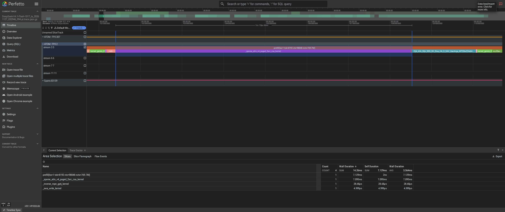
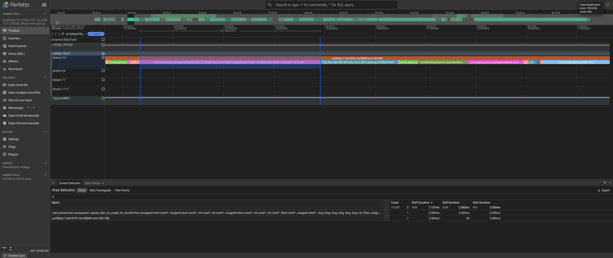
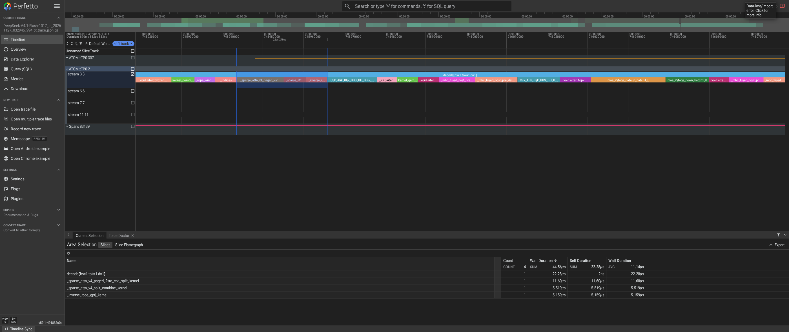
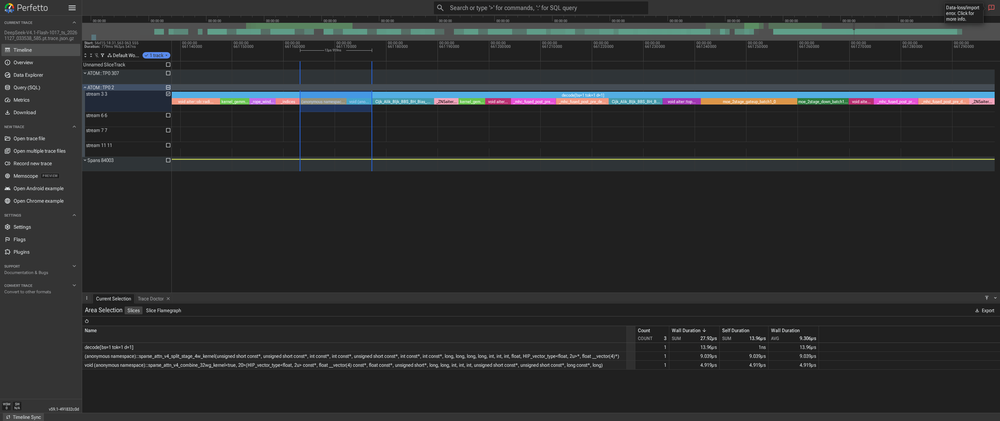

# DeepSeek-V4.1-Flash CSA and Ballot on PTL-enabled MI308X

## What

Retest the ATOM baseline, AITER HIP sparse attention, AITER Ballot top-k, and
the two optimizations together on a single TP4 allocation with a verified PTL
format. The attention library fuses inverse RoPE into the BF16 epilogue. The
Ballot library handles stable K=512 indexer selection in Decode.
[Attention and selector implementations](csa-hip-tp4.md#what) ·
[ATOM adapter patch](evidence/atom-adapter.patch)

In 100K/150 TP4 C1 serving, the repeated HIP-only arm reduced P50 E2E
by **8.90%** and the repeated combined arm by
**9.93%**. The two ATOM baseline starts differed by **0.29%**.

## Data

| Parameter | Setting |
|---|---|
| Platform | Node 52 GPU 0–3, MI308X gfx942, 80 CUs, NUMA 0, TP4, C1, DSpark off |
| PTL | Four selected GPUs read `Enabled / VECTOR,F8` at launch, matched to their PCI BDFs |
| Model | DeepSeek-V4.1-Flash-1017 `08c8657`, native online FP8 PTPC for FFN experts, BF16 KV, FP8 index cache |
| Attention shape | 16 local Q heads, one latent KV head, D=512, RoPE=64, sliding window=128, indexer K=512 |
| Layer schedule | 2 SWA-only layers, 18 ratio-2 CSA+SWA layers and 20 ratio-1 CSA+SWA layers |
| Runtime | Image `cfd987217fc4`, PyTorch 2.10.0, ROCm 7.2.4, AITER runtime `ad0d5e20`, ATOM overlay `b2b8a1b` |
| Serving | 100,000 input / 150 output tokens, 90K prefix prime, 8 matched timed requests with the profiler off, graph capture size 1 |
| Serving limits | Maximum model length 102,400, 64 sequence slots, 8,192-token Prefill chunks, 16-token pages |
| Profiling | Separate 100,000 input / 24 output request with the same prefix and profile prompt across arms |

The runner reads selected GPU identity, PTL state and format immediately
before model-server launch. Separate read-only samples record PTL and GPU
metrics during timing. Each arm uses an independent service start.

## Benchmarking and Profiling

### End-to-end serving

The rows use the first ATOM start as their common baseline. The HIP-only and
combined results come from independent repeats. Ballot and both repeats
completed without sampled foreign GPU activity in the timed request windows.
Each row includes all eight measured requests from its start.

| Comparison, C1 | Output tok/s | P50 TTFT (ms) | P50 TPOT (ms/token) | P50 E2E (ms) |
|---|---:|---:|---:|---:|
| ATOM → Ballot top-k | 79.82 → 82.98 (+3.96%) | 616.38 → 617.53 (+0.19%) | 7.691 → 7.300 (−5.08%) | 1770.17 → 1705.46 (−3.66%) |
| ATOM → HIP sparse attention (repeat) | 79.82 → 88.03 (+10.29%) | 616.38 → 528.22 (−14.30%) | 7.691 → 7.249 (−5.75%) | 1770.17 → 1612.64 (−8.90%) |
| ATOM → HIP sparse attention + Ballot top-k (repeat) | 79.82 → 88.73 (+11.16%) | 616.38 → 531.74 (−13.73%) | 7.691 → 7.140 (−7.16%) | 1770.17 → 1594.30 (−9.93%) |

Adding Ballot to the repeated HIP-attention configuration changed P50 E2E by
**−1.14%** and P50 TPOT by
**−1.50%**.
Using the second ATOM start as the reference gives P50 E2E changes of
**−8.63%** for HIP attention
and **−9.67%** for both optimizations.
[Paired timings and output hashes for all seven starts](evidence/ptl-enabled/serving.json) ·
[Exact workload and enabled flags](evidence/ptl-enabled/benchmark-setup.json)

### ATOM baseline repeat

Both current baseline starts used the same eight prompts and each prompt hit
89,984 cached tokens. They bracketed the first four-arm comparison. P50 E2E
changed by **−0.29%** across the two starts.

| Node 52 baseline | PTL readback for selected GPUs | P50 TTFT (ms) | P50 TPOT (ms/token) | P50 E2E (ms) |
|---|---|---:|---:|---:|
| November 24 historical start | Unavailable | 617.42 | 7.582 | 1,768.28 |
| November 27 earlier start | GPU 0 Disabled, GPUs 1–3 Enabled / VECTOR,F8 | 736.87 | 9.329 | 2,132.45 |
| Current first start | All four Enabled / VECTOR,F8 | 616.38 | 7.691 | 1,770.17 |
| Current independent baseline repeat | All four Enabled / VECTOR,F8 | 621.28 | 7.570 | 1,765.00 |

The four ranks in the current first baseline ran the same 59 Triton CSA
Prefill calls in **171.37–171.87 ms**. The earlier November 27 capture
recorded **219.02 ms** on GPU 0 and **171.01–171.14 ms** on its peers.
The historical launches pre-captured multiple graph sizes. The current
launches pre-captured batch 1, which is also the measured Decode batch.
Historical per-GPU clocks and PTL readbacks are incomplete.
[November 24 model profile](../indexer-topk/indexer-topk-e2e-breakdown.md) ·
[Current PTL and GPU observations](evidence/ptl-enabled/ptl-telemetry.json) ·
[Historical baseline evidence](evidence/ptl-enabled/historical-baselines.json)

### First-start incidents

The first HIP-only start recorded a 5.973 s TTFT on seed 1005 and a
29.411 s gap between streamed chunks on seed 1006. That run's complete
eight-request E2E mean was 6,343.678 ms and throughput was 23.63 tok/s.
Twelve of the fifteen sampled points in the long streaming gap had 0% GFX
activity on all four GPUs. The PTL state and format readbacks matched and
no external GPU process was observed during the gap. The exact server
stall location remains unresolved.

In the first combined start, an external GPU 1 queue was observed during
requests 1005 and 1006 and in the profiling stage. The source timings remain
in the record, including the full first-run throughput.
[First-start observations](evidence/ptl-enabled/first-start-anomalies.json)

| First start, all eight requests | P50 TTFT (ms) | P50 TPOT (ms/token) | P50 E2E (ms) | Output tok/s |
|---|---:|---:|---:|---:|
| HIP sparse attention, two long-tail requests | 530.88 | 7.507 | 1,665.78 | 23.63 |
| HIP sparse attention + Ballot, observed GPU overlap | 530.98 | 7.011 | 1,576.65 | 88.66 |

### Rank 0 profile

The original 100K/24 traces compare the first ATOM and HIP-attention starts.
Both arms executed 60 attention calls across two Prefill chunks and 40 calls
per Decode graph. The HIP path fused inverse RoPE, including in split combine.

| Metric | ATOM baseline → AITER HIP sparse attention |
|---|---:|
| Prefill attention and inverse RoPE, sum of both chunks | 172.748 → 85.542 ms (−50.48%) |
| Prefill main-stream span, sum of both chunks | 571.766 → 484.327 ms (−15.29%) |
| Decode attention and inverse RoPE, P50 per replay | 0.914 → 0.535 ms (−41.52%) |
| Decode GPU graph span, P50 per replay | 7.862 → 7.473 ms (−4.95%) |

[Per-phase and per-replay measurements](evidence/ptl-enabled/attention-profile.json)

The screenshots select the third attention call in model order, attributed to
layer 2, for the 8,192-token Prefill chunk at context 98,048 and for Decode graph
replay 13. The native import diagnostics and original file hashes are recorded
in the capture manifest.
[Capture manifest](evidence/ptl-enabled/perfetto/capture-manifest.json)

#### Prefill

**Before**

[Open prefill before in Perfetto](https://ui.perfetto.dev/#!/?url=https%3A%2F%2Fraw.githubusercontent.com%2FTianHao65%2FATOM%2F7493e71bc5f1d6de74c330e2219ba24d5b2770d6%2Foperators%2Fsparse-attention%2Fevidence%2Fptl-enabled%2Fperfetto%2Frank0-before.trace.json.gz&visStart=4893160007673825&visEnd=4893160017673825&table=slice&ts=4893160008373825&dur=7095186)

**After**

[Open prefill after in Perfetto](https://ui.perfetto.dev/#!/?url=https%3A%2F%2Fraw.githubusercontent.com%2FTianHao65%2FATOM%2F7493e71bc5f1d6de74c330e2219ba24d5b2770d6%2Foperators%2Fsparse-attention%2Fevidence%2Fptl-enabled%2Fperfetto%2Frank0-after.trace.json.gz&visStart=4893511663713152&visEnd=4893511673713152&table=slice&ts=4893511664413152&dur=3565254)

#### Decode

**Before**

[Open decode before in Perfetto](https://ui.perfetto.dev/#!/?url=https%3A%2F%2Fraw.githubusercontent.com%2FTianHao65%2FATOM%2F7493e71bc5f1d6de74c330e2219ba24d5b2770d6%2Foperators%2Fsparse-attention%2Fevidence%2Fptl-enabled%2Fperfetto%2Frank0-before.trace.json.gz&visStart=4893160652889972&visEnd=4893160653049972&table=slice&ts=4893160652914972&dur=11599)

**After**

[Open decode after in Perfetto](https://ui.perfetto.dev/#!/?url=https%3A%2F%2Fraw.githubusercontent.com%2FTianHao65%2FATOM%2F7493e71bc5f1d6de74c330e2219ba24d5b2770d6%2Foperators%2Fsparse-attention%2Fevidence%2Fptl-enabled%2Fperfetto%2Frank0-after.trace.json.gz&visStart=4893512224201804&visEnd=4893512224361804&table=slice&ts=4893512224226804&dur=9039)

### GPU work by kernel family

The 100K/24 rank-0 baseline and combined-repeat traces sum GPU kernel and copy
times over both Prefill chunks and 24 Decode graphs, including overlap between
streams. The projections row includes generic GEMMs and other common kernels.

| Family | ATOM baseline, ms (share) | HIP sparse attention + Ballot repeat, ms (share) |
|---|---:|---:|
| TP collectives | 72.95 (9.38%) | 5776.75 (90.51%) |
| Projections and other GPU work | 179.22 (23.03%) | 179.47 (2.81%) |
| MoE routing and expert kernels | 145.43 (18.69%) | 145.56 (2.28%) |
| mHC | 103.88 (13.35%) | 103.76 (1.63%) |
| Sparse attention and inverse RoPE | 194.69 (25.02%) | 98.40 (1.54%) |
| Indexer scoring and selection | 75.12 (9.65%) | 71.98 (1.13%) |
| Embedding and Engram kernels | 4.37 (0.56%) | 4.34 (0.07%) |
| Device copies and fills | 2.14 (0.28%) | 2.12 (0.03%) |
| Sampling kernels | 0.28 (0.04%) | 0.27 (0.00%) |
| **Total** | **778.07 (100%)** | **6382.66 (100%)** |

[All-rank GPU measurements](evidence/ptl-enabled/model-gpu-work.json)

## Validation

- All seven service starts passed the prompt smoke check and completed all
  56 timed requests. Every timed request hit 89,984 cached tokens and
  generated exactly 150 tokens. [Timed results](evidence/ptl-enabled/serving.json)
- The 201 PTL readbacks across startup, measurement, profiling and cleanup
  matched PCI BDF, `Enabled` state and `VECTOR,F8` format on the selected GPUs.
  The repeat timings had no observed foreign GPU overlap. All owned containers
  and the test port were released. [PTL snapshots and telemetry](evidence/ptl-enabled/ptl-telemetry.json)
- All 24 original rank traces matched the capture hashes. Every HIP arm rank
  executed 59 unsplit and 961 split-stage/combine calls. Each Ballot arm
  rank executed 192 stable K512 selectors. [Dispatch evidence](evidence/ptl-enabled/dispatch.json)
- The two original ATOM starts had 0/8 identical greedy SSE output hashes.
  Matched timings test serving performance. Model-level accuracy remains
  unmeasured. [Prior operator correctness](csa-hip-tp4.md#validation)
