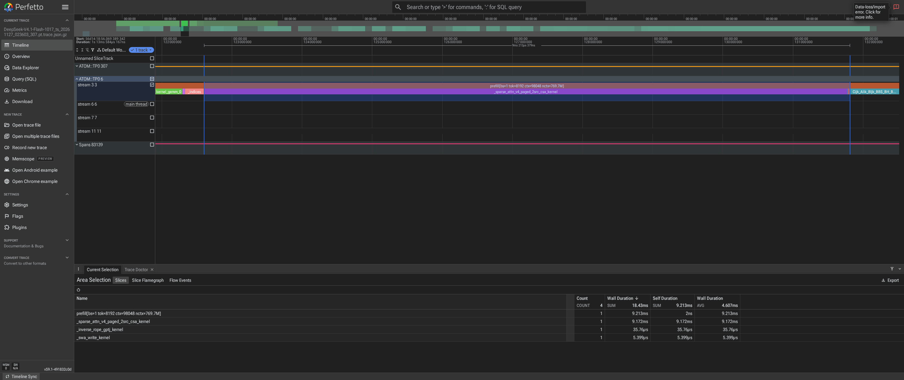
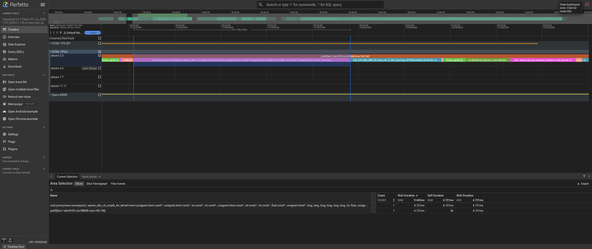
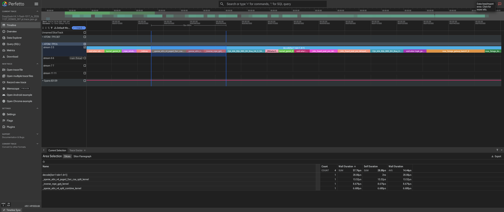
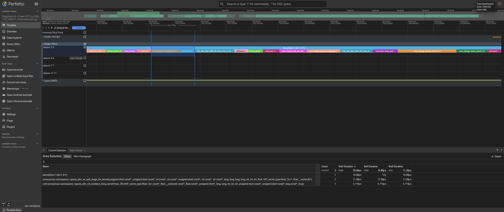

# gfx942 HIP sparse attention on DeepSeek-V4.1-Flash

## What

Evaluate AITER's gfx942 two-source sparse attention on DeepSeek-V4.1-Flash. The
HIP kernel reads the compressed and window KV sources, and fuses inverse RoPE
into its BF16 output epilogue. The ATOM adapter passes its existing CSR
indices, sink, KV pools, and active RoPE tables to the pinned kernel. It is
enabled with `ATOM_DSV41_HIP_SPARSE_ATTN_LIB`. The previously tested AITER
Ballot selector remains independently configurable.
[AITER attention kernel](https://github.com/ROCm/aiter/commit/3dcbc414ca0bc0c061a7073cd4dfaa10de97f550) ·
[ATOM adapter patch](evidence/atom-adapter.patch) ·
[AITER Ballot kernel](https://github.com/ROCm/aiter/commit/7f36447ac7a235d15d8de7b4598c2c167d85da67)

For 100K/150 TP4 C1 serving, P50 E2E fell **7.78%** with HIP attention and
**8.91%** with HIP attention and Ballot top-k together.

## Data

| Parameter | Setting |
|---|---|
| Model | DeepSeek-V4.1-Flash-1017 `08c8657`, native online FP8 PTPC for FFN experts, BF16 KV, FP8 index cache, DSpark off |
| Attention | TP4 with 16 local Q heads, one latent KV head, head dim 512, interleaved RoPE dim 64, sliding window 128, indexer K=512 |
| Layer schedule | 2 SWA-only layers, 18 ratio-2 CSA+SWA layers and 20 ratio-1 CSA+SWA layers |
| Runtime | MI308X gfx942 (80 CUs), PyTorch 2.10.0, ROCm 7.2.4, AITER runtime `ad0d5e20`, ATOM overlay `b2b8a1b` based on `e26da2a` |
| Serving | Node 19 GPUs 4–7, image `7d2b9b52053b`, TP4 C1 with graph capture size 1, 100,000 input / 150 output tokens, 90K shared-prefix prime, 8 matched requests per arm, separate server starts, profiler off |
| Serving limits | Maximum model length 102,400, 64 sequence slots, 8,192-token Prefill chunks and 16-token pages |
| Profiling | Separate 100,000 input / 24 output C1 request per arm, same prefix and prompt across arms |
| Isolated operator | Node 52 GPU 4, image `cfd987217fc4`, synthetic BF16 Q and paged KV with the TP4 head shape and checkpoint RoPE, Decode batches 1/4/8 and bounded Prefill row sizes |

The two libraries are built for `gfx942` and loaded into the same runtime for
each enabled arm. The candidate uses the existing ATOM BF16 output projection
with inverse RoPE already applied by the HIP epilogue.
[Base ATOM revision](https://github.com/TianHao65/ATOM/commit/e26da2ae6e2b7a85bd8cde2a9f67f8238a3f276f)

## Benchmarking and Profiling

### End-to-end serving

All four arms used the same eight prompts and each request hit 89,984 cached
tokens. The table uses one independent server start per arm.

| Comparison, C1 | Output tok/s | P50 TTFT (ms) | P50 TPOT (ms/token) | P50 E2E (ms) |
|---|---:|---:|---:|---:|
| ATOM baseline → HIP sparse attention | 68.94 → 74.25 (+7.70%) | 750.03 → 641.76 (−14.44%) | 8.974 → 8.606 (−4.10%) | 2086.26 → 1923.91 (−7.78%) |
| ATOM baseline → Ballot top-k | 68.94 → 69.73 (+1.14%) | 750.03 → 749.65 (−0.05%) | 8.974 → 8.802 (−1.92%) | 2086.26 → 2062.70 (−1.13%) |
| ATOM baseline → HIP sparse attention + Ballot top-k | 68.94 → 75.49 (+9.50%) | 750.03 → 643.06 (−14.26%) | 8.974 → 8.437 (−5.99%) | 2086.26 → 1900.36 (−8.91%) |

The following rows measure each incremental change with the other optimization
already enabled.

| Comparison, C1 | Output tok/s | P50 TTFT (ms) | P50 TPOT (ms/token) | P50 E2E (ms) |
|---|---:|---:|---:|---:|
| HIP sparse attention → HIP sparse attention + Ballot top-k | 74.25 → 75.49 (+1.67%) | 641.76 → 643.06 (+0.20%) | 8.606 → 8.437 (−1.96%) | 1923.91 → 1900.36 (−1.22%) |
| Ballot top-k → HIP sparse attention + Ballot top-k | 69.73 → 75.49 (+8.26%) | 749.65 → 643.06 (−14.22%) | 8.802 → 8.437 (−4.14%) | 2062.70 → 1900.36 (−7.87%) |

Mean E2E moved from 2,169.310 ms to 2,013.248 ms with HIP sparse attention
alone and to 1,980.698 ms with both optimizations. For the HIP-only comparison,
mean TTFT accounted for 101.142 ms of the 156.061 ms mean E2E reduction.
[Matched request timings](evidence/serving.json) · [Exact configuration](evidence/benchmark-setup.json)

### Isolated sparse attention and inverse RoPE

The ATOM column includes its separate inverse RoPE launch. Timing uses the median
of eight alternating GPU-event rounds, each with 200 graph replays for Decode
or 10 eager calls for Prefill. Decode rows sum per-case medians weighted by the
38 CSA+SWA and 2 SWA-only layers. The Prefill row weights both encoder buckets
(8,192 and 1,952 live rows, the latter padded to 2,048) and the decoder's bounded
replay (19 × 128 rows plus one final query).

| Shape and phase | ATOM Triton + inverse RoPE | AITER HIP fused | Latency change |
|---|---:|---:|---:|
| Decode C1, µs/step | 793.32 | 644.49 | −18.76% |
| Decode C4, µs/step | 929.14 | 826.09 | −11.09% |
| Decode C8, µs/step | 1,155.03 | 926.07 | −19.82% |
| Prefill layer-weighted sum, ms | 103.33 | 84.16 | −18.55% |

[Per-shape timings and numerical checks](evidence/microbench.json) ·
[Operator benchmark script](evidence/bench_atom_sparse_attention.py)

### Rank 0 100K/24 profile

Both arms executed 60 sparse-attention calls across two Prefill chunks and
40 calls per Decode replay. The HIP epilogue absorbed the separate inverse
RoPE launch in all four ranks. The attention row sums both split stages when
present. Graph span runs from the first GPU event in a replay to the last.

| Metric | ATOM baseline → AITER HIP sparse attention |
|---|---|
| Prefill attention and inverse RoPE, sum of both chunks | 219.528 → 111.475 ms (−49.22%) |
| Prefill main-stream span, sum of both chunks | 698.440 → 589.338 ms (−15.62%) |
| Decode attention and inverse RoPE, p50 per replay | 1.085 → 0.644 ms (−40.66%) |
| Decode GPU graph span, p50 per replay | 9.379 → 8.895 ms (−5.17%) |

[Per-phase and per-replay measurements](evidence/attention-profile.json)

The screenshots show the third attention call in model order, attributed to
layer 2, for the 8,192-row Prefill chunk at context 98,048 and Decode replay 13.
The capture manifest records the original hashes, Perfetto's importer
diagnostics and the verified slice positions.
[Original trace capture manifest](evidence/perfetto/capture-manifest.json)

#### Prefill

**Before**

[Open prefill before in Perfetto](https://ui.perfetto.dev/#!/?url=https%3A%2F%2Fraw.githubusercontent.com%2FTianHao65%2FATOM%2F0d332af529c8c393d0690766a0b3f771d946a25f%2Foperators%2Fsparse-attention%2Fevidence%2Fperfetto%2Frank0-before.trace.json.gz&visStart=4889936191290589&visEnd=4889936201903968&table=slice&ts=4889936191990589&dur=9172218)

**After**

[Open prefill after in Perfetto](https://ui.perfetto.dev/#!/?url=https%3A%2F%2Fraw.githubusercontent.com%2FTianHao65%2FATOM%2F0d332af529c8c393d0690766a0b3f771d946a25f%2Foperators%2Fsparse-attention%2Fevidence%2Fperfetto%2Frank0-after.trace.json.gz&visStart=4890310127326592&visEnd=4890310137939971&table=slice&ts=4890310128026592&dur=4720846)

#### Decode

**Before**

[Open decode before in Perfetto](https://ui.perfetto.dev/#!/?url=https%3A%2F%2Fraw.githubusercontent.com%2FTianHao65%2FATOM%2F0d332af529c8c393d0690766a0b3f771d946a25f%2Foperators%2Fsparse-attention%2Fevidence%2Fperfetto%2Frank0-before.trace.json.gz&visStart=4889936938189665&visEnd=4889936938349665&table=slice&ts=4889936938214665&dur=13519)

**After**

[Open decode after in Perfetto](https://ui.perfetto.dev/#!/?url=https%3A%2F%2Fraw.githubusercontent.com%2FTianHao65%2FATOM%2F0d332af529c8c393d0690766a0b3f771d946a25f%2Foperators%2Fsparse-attention%2Fevidence%2Fperfetto%2Frank0-after.trace.json.gz&visStart=4890310761038157&visEnd=4890310761198157&table=slice&ts=4890310761063157&dur=11079)

### GPU work by kernel family

The 100K/24 rank-0 capture includes both Prefill chunks and all 24 Decode graphs.
Shares use summed kernel, copy and fill durations, including overlap between
streams. The projections row includes remaining shared kernel families, such as
generic GEMMs, normalization and the LM head.

| Family | ATOM baseline, ms (share) | HIP sparse attention + Ballot, ms (share) |
|---|---:|---:|
| Projections and other GPU work | 217.51 (23.31%) | 217.28 (26.86%) |
| MoE routing and expert kernels | 167.22 (17.92%) | 167.11 (20.65%) |
| mHC | 127.14 (13.62%) | 127.29 (15.73%) |
| Sparse attention and inverse RoPE | 245.58 (26.32%) | 126.81 (15.67%) |
| Indexer scoring and selection | 100.52 (10.77%) | 96.38 (11.91%) |
| TP collectives | 68.34 (7.32%) | 66.76 (8.25%) |
| Embedding and Engram kernels | 5.32 (0.57%) | 5.33 (0.66%) |
| Device copies and fills | 1.29 (0.14%) | 1.81 (0.22%) |
| Sampling kernels | 0.31 (0.03%) | 0.31 (0.04%) |
| **Total** | **933.23 (100%)** | **809.08 (100%)** |

[GPU work across all ranks and arms](evidence/model-gpu-work.json)

## Validation

- All 18 isolated cases passed the BF16 comparison. The largest absolute error
  with fused inverse RoPE was 0.001465 at an acceptance threshold of 0.02. All
  padded output rows were exactly zero. [Isolated validation](evidence/microbench.json)
- Six eager tests exercised the actual ATOM adapter. The four split cases
  also matched exactly under graph replay, including empty CSR and padded
  Decode rows. The two unsplit Prefill cases reached a maximum absolute error
  of 0.0004883. [Adapter validation](evidence/adapter-validation.json)
- The four serving smoke checks and all 32 timed requests completed. Across
  the 16 original rank traces, each HIP arm rank executed 59 unsplit calls
  and 961 split-stage/combine pairs with fused inverse RoPE. Each Ballot arm
  rank ran 192 stable K512 selector calls. [Dispatch counts and trace hashes](evidence/dispatch.json)
- Compared with the baseline, greedy SSE output hashes matched 2/8 prompts
  for HIP attention alone, 1/8 for Ballot alone, and 2/8 for the combined arm.
  Task-level accuracy remains unmeasured. [Paired outputs](evidence/serving.json)
- GPU ownership sampling found zero foreign processes on the serving
  allocation. Each owned container exited and the port was released. The
  read-only PTL query on node 19 returned `N/A` for state and format throughout
  the samples. [Resource observations](evidence/serving.json)
